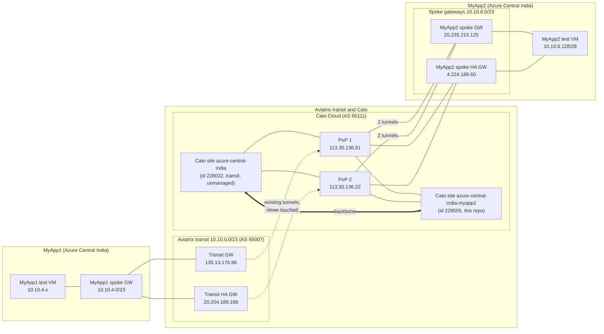

# Cato test: MyApp2 spoke <-> MyApp1 through Cato (IPsec IKEv2 + BGP)

Connects the Azure Central India spoke `azr-ci-spoke-MyApp2-avx` to Cato Networks with
IPsec (IKEv2) and BGP. The spoke is **not attached to the Aviatrix transit**: Cato is its
only path off the VNet. Terraform builds both ends (Cato provider + Aviatrix provider).

## Architecture



Both Cato sites share the same two PoP public IPs. The transit connection (`Cato`, in
`../s2c`) is independent and stays up; it uses the other site.

## Tunnels

BGP runs inside the tunnels. Aviatrix side is the first host of each /30, Cato the second.

| Cato PoP | Spoke gateway | Aviatrix IP | Cato IP |
|---|---|---|---|
| 113.30.136.81 | MyApp2 (20.235.215.125) | 192.168.20.17/30 | 192.168.20.18/30 |
| 113.30.136.81 | MyApp2 HA (4.224.188.60) | 192.168.20.21/30 | 192.168.20.22/30 |
| 113.30.136.22 | MyApp2 (20.235.215.125) | 192.168.20.25/30 | 192.168.20.26/30 |
| 113.30.136.22 | MyApp2 HA (4.224.188.60) | 192.168.20.29/30 | 192.168.20.30/30 |

The transit tunnels use 192.168.20.0 to 192.168.20.15 and must not overlap.

IKEv2, AES-256-CBC, SHA-256, DH group 14, set explicitly on the Cato site (init and auth
messages); these are also the Aviatrix defaults, so no custom algorithms on the Aviatrix
connection.

## The test: MyApp2 VM <-> MyApp1 VM, through Cato

The traffic between the two spokes does **not** go through the Aviatrix transit directly.
MyApp2 is not attached to the transit, so it has to leave through Cato and come back in
through the other Cato site (the transit one).

Ping from the MyApp2 test VM (`10.10.6.x`) to the MyApp1 test VM (`10.10.4.x`):

1. **MyApp2 VM to its spoke gateway.** The VM subnet route table sends `0.0.0.0/0`,
   `10/8`, `172.16/12` and `192.168/16` to the MyApp2 spoke gateway (`10.10.6.4`).
   Aviatrix programs these (see `private_route_table_config` in `../spoke`).
2. **MyApp2 gateway to Cato.** The gateway picks one of the four IPsec tunnels (ECMP) for
   the destination, using the BGP routes learned from Cato (AS 65111), and the packet goes
   to a PoP.
3. **Across Cato.** The backbone moves it from site `azure-central-india-myapp2` to site
   `azure-central-india`, whose tunnels end on the Aviatrix transit. That site's native
   range is `10.10.4.0/23`, the MyApp1 VNet.
4. **Cato to the transit, then MyApp1.** The packet comes in through one of the transit
   tunnels, the transit gateway forwards it to the MyApp1 spoke gateway, which delivers it
   to the MyApp1 VM.
5. **Reply.** The same path in reverse. It returns because the MyApp2 spoke advertises
   `10.10.6.0/23` over BGP (AS 65012) and the MyApp1 side is known to Cato through the
   transit's BGP (AS 65007).

Pinging from the MyApp1 VM to the MyApp2 VM follows the mirror path: MyApp1 gateway, transit,
Cato (transit site), Cato (MyApp2 site), a MyApp2 tunnel, MyApp2 gateway, MyApp2 VM.

If a ping fails, check in this order:
- All 8 tunnels Up (4 on `Cato-MyApp2`, 4 on `Cato`) and BGP established on both ends.
- `10.10.6.0/23` is known on the transit side and `10.10.4.0/23` on the MyApp2 side
  (`show ip bgp` on the spoke gateways and the transit).
- Cato firewall and Aviatrix DCF allow ICMP; the VMs' own firewall too.
- No overlapping prefixes between the two sites.

## Checks

```
# Aviatrix: all 4 tunnels Up
aviatrix_get_s2c_connection_details  connection_name=Cato-MyApp2

# BGP on each spoke gateway (expect 2 established neighbors each)
show ip bgp summary           # gateways azr-ci-spoke-MyApp2-avx and ...-hagw
```

Expected neighbors: 192.168.20.18 and .26 on the primary gateway, .22 and .30 on the HA
gateway, all AS 65111.

## Terraform

| File | What |
|---|---|
| `main.tf` | Cato site + BGP peers, Aviatrix `aviatrix_spoke_external_device_conn` |
| `variables.tf` | Inputs (Cato key, account, PSK, PoP IPs, AS numbers) |
| `versions.tf` | Providers and HCP workspace `aviatrix-shared-cato` |

- Cato site `azure-central-india` (228022, transit tunnels) is imported with
  `ignore_changes = all`: Terraform never changes it. Cato allows at most 3 tunnels per
  PoP on a site, which is why the spoke has its own site.
- `terraform.tfvars` holds the secrets (`cato_api_key`, `cato_account_id`, `cato_ipsec_psk`)
  and is gitignored.
- Cato calls should run one at a time: set `TFE_PARALLELISM=1` on the workspace if Cato
  operations fail.
