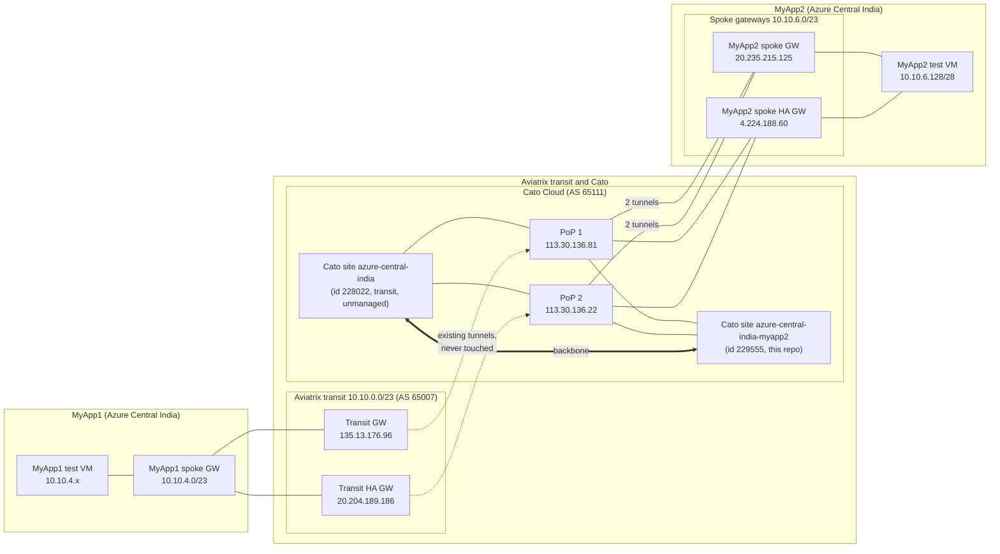

# Cato test: MyApp2 spoke <-> MyApp1 through Cato (IPsec IKEv2 + BGP)

Connects the Azure Central India spoke `azr-ci-spoke-MyApp2-avx` to Cato Networks with
IPsec (IKEv2) and BGP. The spoke is **not attached to the Aviatrix transit**: Cato is its
only path off the VNet. Terraform builds both ends (Cato provider + Aviatrix provider).

## Architecture



Both Cato sites share the same two PoP public IPs. The transit and the MyApp2 spoke each have
their own Cato site and one HA (full mesh) Aviatrix connection: `Cato` on the transit and
`Cato-MyApp2` on the spoke, each with PoP 1 as primary peer and PoP 2 as backup peer (4 tunnels:
each Aviatrix gateway to each PoP). Everything is built in this workspace and shares one PSK
variable (`cato_ipsec_psk`).

Cato itself treats the secondary PoP of an IPsec site as a backup (it adds an extra AS to its
routes), so even with no prepend on our side, PoP 1 stays preferred for traffic towards us.
Inside each PoP both Aviatrix gateways (primary + HA) keep a tunnel and are active/active.

## Tunnels

BGP runs inside the tunnels. Aviatrix side is the first host of each /30, Cato the second.

| Cato PoP | Spoke gateway | Aviatrix IP | Cato IP |
|---|---|---|---|
| 113.30.136.81 | MyApp2 (20.235.215.125) | 192.168.20.17/30 | 192.168.20.18/30 |
| 113.30.136.81 | MyApp2 HA (4.224.188.60) | 192.168.20.21/30 | 192.168.20.22/30 |
| 113.30.136.22 | MyApp2 (20.235.215.125) | 192.168.20.25/30 | 192.168.20.26/30 |
| 113.30.136.22 | MyApp2 HA (4.224.188.60) | 192.168.20.29/30 | 192.168.20.30/30 |

The transit tunnels use 192.168.20.0 to 192.168.20.15 and must not overlap.

IKEv2, AES-256-CBC, SHA-256, DH group 14, set explicitly on the Cato site (init and auth
messages); these are also the Aviatrix defaults, so no custom algorithms on the Aviatrix
connection.

## The test: MyApp2 VM <-> MyApp1 VM, through Cato

The traffic between the two spokes does **not** go through the Aviatrix transit directly.
MyApp2 is not attached to the transit, so it has to leave through Cato and come back in
through the other Cato site (the transit one).

Ping from the MyApp2 test VM (`10.10.6.x`) to the MyApp1 test VM (`10.10.4.x`):

1. **MyApp2 VM to its spoke gateway.** The VM subnet route table sends `0.0.0.0/0`,
   `10/8`, `172.16/12` and `192.168/16` to the MyApp2 spoke gateway (`10.10.6.4`).
   Aviatrix programs these (see `private_route_table_config` in `../spoke`).
2. **MyApp2 gateway to Cato.** The gateway picks one of the four IPsec tunnels (ECMP) for
   the destination, using the BGP routes learned from Cato (AS 65111), and the packet goes
   to a PoP.
3. **Across Cato.** The backbone moves it from site `azure-central-india-myapp2` to site
   `azure-central-india`, whose tunnels end on the Aviatrix transit. That site's native
   range is `10.10.4.0/23`, the MyApp1 VNet.
4. **Cato to the transit, then MyApp1.** The packet comes in through one of the transit
   tunnels, the transit gateway forwards it to the MyApp1 spoke gateway, which delivers it
   to the MyApp1 VM.
5. **Reply.** The same path in reverse. It returns because the MyApp2 spoke advertises
   `10.10.6.0/23` over BGP (AS 65012) and the MyApp1 side is known to Cato through the
   transit's BGP (AS 65007).

Pinging from the MyApp1 VM to the MyApp2 VM follows the mirror path: MyApp1 gateway, transit,
Cato (transit site), Cato (MyApp2 site), a MyApp2 tunnel, MyApp2 gateway, MyApp2 VM.

If a ping fails, check in this order:
- All 4 tunnels Up on each connection (`Cato`, `Cato-MyApp2`) and BGP established on both ends.
- `10.10.6.0/23` is known on the transit side and `10.10.4.0/23` on the MyApp2 side
  (`show ip bgp` on the spoke gateways and the transit).
- Cato firewall and Aviatrix DCF allow ICMP; the VMs' own firewall too.
- No overlapping prefixes between the two sites.

## Checks

```
# Aviatrix: tunnels Up on each connection
aviatrix_get_s2c_connection_details  connection_name=Cato-MyApp2   # and Cato (transit)

# BGP on the spoke gateway (2 neighbors with both PoPs) and on the transit gateway
show ip bgp summary           # gateways azr-ci-spoke-MyApp2-avx and ...-hagw
```

Expected neighbors: 192.168.20.18 and .26 on the primary gateway, .22 and .30 on the HA
gateway, all AS 65111.

## Terraform

| File | What |
|---|---|
| `main.tf` | Cato sites + BGP peers, Aviatrix connections for the spoke (`aviatrix_spoke_external_device_conn`) and the transit (`aviatrix_transit_external_device_conn`) |
| `variables.tf` | Inputs (Cato key, account, PSK, PoP IPs, AS numbers) |
| `versions.tf` | Providers and HCP workspace `aviatrix-shared-cato` |

- Cato site `azure-central-india` (228022, the transit) was imported; Terraform manages its
  IPsec tunnels (name, location and range are ignored). Cato allows at most 3 tunnels per PoP
  on a site, which is why the spoke has its own site (229555).
- The Cato BGP peers on the transit site (4 of them) are not in Terraform.
- Changing a PSK forces replacement of the Aviatrix connections (tunnels drop). Cato calls
  must run one at a time (`TFE_PARALLELISM=1` if needed); HCP Terraform rejects `-parallelism`.
- `terraform.tfvars` holds the secrets (`cato_api_key`, `cato_account_id`, `cato_ipsec_psk`)
  and is gitignored.
- Cato calls should run one at a time: set `TFE_PARALLELISM=1` on the workspace if Cato
  operations fail.

## Test log (2026-11-23 / 24)

Lab tests run against this setup. Sources: Gatus VMs in MyApp1, a continuous ping from a WSL2
host on the ferme network, Aviatrix controller BGP/DCF views. Gatus (7 sources + 1 dashboard in
MyApp1, `app1_gatus_*` in `../spoke`) probes ICMP to 10.10.6.4, 10.10.6.68, 10.10.6.132 and
TCP 22 on 10.10.6.132 every 10 s.

| # | Test | Result |
|---|---|---|
| 1 | IPsec IKEv2 + BGP, transit and MyApp2 spoke, both PoPs | Works once the PSK is identical on both ends. A PSK mismatch kept the transit tunnels down for a while. |
| 2 | Ping from on-prem to the MyApp2 VM | SSH worked while ping failed; cause not confirmed. It cleared after rebuilds with matching PSKs. |
| 3 | Continuous ping, about 76 min | About 0.6% loss on the gateways: single pings missed on all targets at once (shared events, about every 40 s at times). Paths flip between the two transit and two spoke gateways, i.e. active/active at the gateways. |
| 4 | Make a PoP primary/backup (AS-path prepend, Cato BGP peer metric) | Cato already treats the secondary PoP as the backup by itself (extra AS on its routes). Our prepend is not visible to Cato's routes (Cato re-originates them as AS 65111); the metric arrives as BGP MED but does not steer Cato's choice. |
| 5 | Asymmetric PoPs (transit on PoP 2, spoke on PoP 1) | About 70 s outage while the transit re-converged, then clean; no loss from the asymmetry itself. |
| 6 | Asymmetric gateways, same PoP (in via the spoke HA gateway, out via the primary) | 7 of 18 probes took it, 0 failures. The VM route table always sends replies to the primary gateway. |
| 7 | DCF stateful test: permit Gatus to MyApp2, explicit deny on the reply direction | 0 denies and 0 failures even with the asymmetric path. Not conclusive: the check that the deny rule works for a new connection was not done. |
| 8 | Gatus: 7 sources and one dashboard | All 29 endpoints passed. |
| 9 | DCF rule with web group AllWeb at the top (`dcf-statefulness-test.tf`) | Applied (rule at priority 10). Not tested with real web traffic. |
| 10 | Back to HA full mesh (4 tunnels per connection) | BGP up on both PoPs; all 29 Gatus endpoints OK about a minute after the reconnect. |
| 11 | Reverse probes: 6 Gatus VMs in MyApp2 probe the MyApp1 VM (ICMP, TCP 22, TCP 80) and the transit gateways' own IPs (ICMP) | MyApp1 VM: 100% OK from all 6 sources (ICMP, TCP 22, TCP 80). **Transit gateway IPs (10.10.0.36 / .52): deterministic per source and target**, not random: m2src1 (10.10.6.137) 0% to both; m2src4 (10.10.6.136) 0% to .52 only; m2src6 (10.10.6.134) 0% to .36 only; m2src2/3/5 100%. Reproduced after rebuilding the VMs (same IPs). |
| 12 | tcpdump on a failing source (m2src1) vs a working one (m2src2), same subnet and route | Failing: requests leave eth0 (18 in 30 s), **0 replies**. Working: 12/12 replies in about 12 ms. So the loss is after the VM, per flow (source IP). DCF logs: requests reach the MyApp2 gateway and the transit gateway; for the failing source no reply is logged anywhere. |
| 13 | Hypothesis "Cato spreads flows over the two transit tunnels, request and reply use different tunnels": stop the transit HA gateway | **Rejected.** With only the primary transit gateway up, m2src1 and m2src6 still 0/13 to 10.10.0.36 (m2src4 and the others still OK). Transit HA gateway restarted afterwards. |
| 14 | Next hypothesis: replies land on the MyApp2 HA spoke gateway (no state for the request that left via the primary) and are dropped; stop the MyApp2 HA spoke gateway | **Rejected.** With the MyApp2 HA gateway deallocated, m2src1 and m2src6 are still 0/12 and 0/13 to 10.10.0.36 (m2src2 to m2src5 100%). Gateway restarted afterwards. Remaining suspects: Cato-internal per-flow PoP/path choice, or a per-source-IP rule or state in Cato. Next test: single PoP on both sides. |
| 15 | **Single PoP on both sides** (transit `Cato` and spoke `Cato-MyApp2` rebuilt with PoP 1 only, 2 tunnels each; both single-PoP switches true) | **Everything passes.** Last 50 checks per probe (18:23:04 to 18:31:21 UTC): transit group 600/600, spoke group 2300/2300, including m2src1 and m2src6 to 10.10.0.36 and every source to 10.10.0.52. |
| 16 | **Back to HA full mesh** (both single-PoP switches false), same 13 sources | **The failures return**, last 50 checks (18:41:05 to 18:49:26 UTC): transit group 200/600 (m2src1 and m2src6 0/50 to 10.10.0.36; all six sources 0/50 to 10.10.0.52; m2src2 to m2src5 50/50 to 10.10.0.36), spoke group 2300/2300. A clean A/B on one fleet. |
| 17 | Report with both designs, exact settings and tables | [REPORT.md](REPORT.md). |
| 18 | **Test C**: transit on PoP 1 only, spoke still on both PoPs (HA mesh) | **Works**: last 50 checks (18:59:08 to 19:07:28 UTC) transit group 600/600, spoke group 2299/2300. |
| 19 | **Test D**: transit on both PoPs (HA mesh), spoke on PoP 1 only | **Fails like the original**: last ~47 checks (19:16:30 to 19:24:16 UTC) transit group 186/559 (m2src1 and m2src6 0/46 to 10.10.0.36, all sources 0/47 to 10.10.0.52), spoke group 2148/2148. **The trigger is the transit being connected to both PoPs; the spoke does not matter.** |
| 20 | **Test F, the fix**: transit on both PoPs, but Cato BGP peers of the transit site for PoP 2 (192.168.20.9, .13) set to metric 200 (imported into TF, `transit_bgp_peers.tf`); spoke on PoP 1 only | **Works with both PoPs up**: last 50 checks (19:31:54 to 19:40:13 UTC) transit group 600/600, spoke group 2300/2300, zero failures after settling. Hypothesis: with equal metrics Cato spreads inbound flows over all 4 transit peers (both PoPs) while the transit answers via PoP 1; a flow entering on PoP 2 and answered on PoP 1 is dropped. |
| 21 | **Test G**: full target design, transit and spoke both on HA mesh plus the metric 200 fix | **Works**: 19:46:30 to 19:54:26 UTC, transit group 569/569, spoke group 2187/2189 (two isolated single missed pings). This is the recommended design. Raw data: `~/cato-ping/sample_G_*.json`. |

Takeaways:
- Asymmetry alone did not break ICMP or TCP connects here (Gatus MyApp1 to MyApp2, and MyApp2 to the MyApp1 VM).
- ICMP from some MyApp2 sources to the transit gateways' own addresses fails permanently and per flow when both sides connect to both Cato PoPs (HA full mesh, rows 11, 12, 16), and fully works with a single PoP on both sides (row 15). Not caused by the transit tunnel choice (row 13) nor by the MyApp2 HA spoke gateway (row 14). See [REPORT.md](REPORT.md).
- Path changes cost 20 to 70 s of failed probes (convergence), more than asymmetry does.
- Cato, not Aviatrix, decides the PoP preference; Aviatrix prepend and the Cato peer metric did not change it.

Not proven: long-lived TCP flows under asymmetry, and a working stateful deny.

Gotchas seen:
- Changing a PSK forces replacement of the Aviatrix connection (tunnels drop).
- Cato allows at most 3 tunnels per PoP on a site; BGP peer metric range is 50 to 255.
- ACI cannot be used in the MyApp1 VNet (it has an IPv6 range); the VM module also adds a daily 21:00 auto-shutdown unless `enable_auto_shutdown = false` (it stopped the MyApp2 test VM).
- A new BGP peer metric only shows up after Cato re-advertises (a soft inbound refresh helps).

### Gatus layout used for these tests

Private only, reachable over the Aviatrix dataplane (HTTP, port 80). Single dashboard with remote
instances, grouped `transit` (ICMP to the transit gateways) and `spoke` (everything else).

- Dashboard: MyApp1, `gatus_dashboard_url` output (10.10.4.151 in this lab).
- 7 sources in MyApp1 (the original VM 10.10.4.134 and src1 to src6, `app1_gatus_sources.tf`),
  probing MyApp2 (10.10.6.4, 10.10.6.68, 10.10.6.132 ICMP; 10.10.6.132 TCP 22).
- 6 sources in MyApp2 (m2src1 to m2src6 = 10.10.6.137, .133, .135, .136, .138, .134,
  `app2_gatus_sources.tf` in `../spoke`), probing the transit gateways (10.10.0.36, 10.10.0.52
  ICMP) and the MyApp1 VM 10.10.4.134 (ICMP, TCP 22, TCP 80).
- Gatus runs in Docker on each VM; the ICMP probes need `--cap-add NET_RAW` and the
  `net.ipv4.ping_group_range` sysctl (set in the cloud-init files).
- Changing a cloud-init file replaces the VM (same NIC, same IP).
- Raw notes and timestamps: `~/cato-ping/events.log` on the WSL2 host (not in the repo).
- The fleet was destroyed after the tests (`enable_gatus_fleet = false`, default); set it to `true` in the
  `aviatrix-shared-spoke` workspace to recreate it. The temporary DCF rules are off as well.
